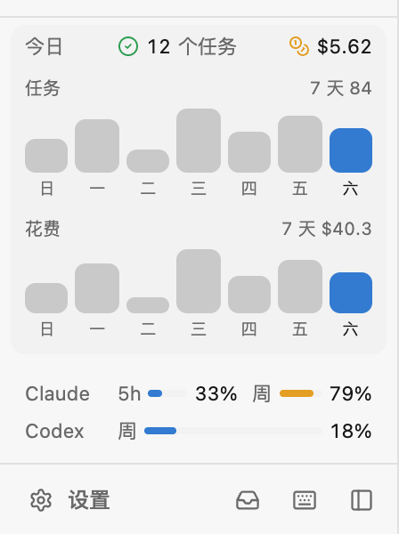

# gerdr-addon

[gerdr](https://github.com/gerdr-dev/gerdr) 的默认扩展商店。在 gerdr 里打开「设置 → 扩展 → 商店」就能浏览、一键安装；不用手动跑什么。

| 扩展 | 做什么 |
|---|---|
| [今日](today) | 侧栏显示今天跑完了几个任务、花了多少钱，点开看 7 天 |
| [额度条](usage-meter) | 侧栏底部常驻 Claude Code / Codex 的额度和重置时间 |
| [常用短语](quick-phrases) | 输入框旁一个 ⚡，一点就填常说的话；右键把选中的文字引用到输入框 |
| [复制 tab](duplicate-tab) | `prefix+a` / `prefix+i` 把当前 tab 复制到后面 / 前面 |
| [跑完了通知我](notify-when-done) | 看不见的会话跑完了或在等你时，弹系统通知 |
| [会话标题：每 5 句重起](session-title) | 示例：自己定会话标题怎么起 |



## 写一个扩展

一个扩展就是一个文件夹，有 `addon.json`（商店靠它认出扩展）和 `index.ts` / `index.tsx`：

```
my-addon/
  addon.json      {"name": "…", "version": "1.0.0", "description": "…", "icon": "icon.svg", "screenshots": ["screenshot.png"]}
  index.tsx       export default defineAddon({ setup(g) { … } })
  README.md       商店里「说明」展开显示；图片写相对路径就行
  screenshot.png  商店列表里直接显示，最好放一张
```

扩展能做的事（完整 API 见 [gerdr.d.ts](gerdr.d.ts)，它是 gerdr 写进 `~/.gerdr/addons` 那份的拷贝）：

- **画界面**：`g.slot("sidebar" | "paneTitle", 组件)`、`g.composerAction`（输入框底栏的按钮）、`g.contextMenu`（右键菜单）；`.tsx` 里直接写 JSX，hooks 用 `g.React`，组件用 `g.ui`，图标用 `g.icons`（lucide）。
- **改名字**：`g.tabLabel` / `g.paneTitle` / `g.workspaceLabel` / `g.sessionTitle`。
- **命令和快捷键**：`g.command`。
- **听事件、做动作**：`g.on("turnEnd" | "needsInput" | "sessionCreated" | "focusChanged" | "stats")`、`g.actions.*`、`g.notify`。
- **数据**：`g.state()`、`g.usage()`（额度）、`g.stats()`（每天完成数和花费）、`g.storage`。
- **资源文件**：`g.asset("icon.png")` 拿到扩展文件夹里文件的地址。
- **后台进程**：`addon.json` 里写 `service`，gerdr 后端负责起、挂了重启（比如一直连着蓝牙手环）。

边写边试：把文件夹放进 `~/.gerdr/addons`（保存即生效），或者在「商店」页把这个仓库的本地目录加成商店（本机绝对路径也能当商店），从那里装。

任何照这个结构摆的 GitHub 仓库都是一个商店：在商店页填 `owner/repo` 加进去。
