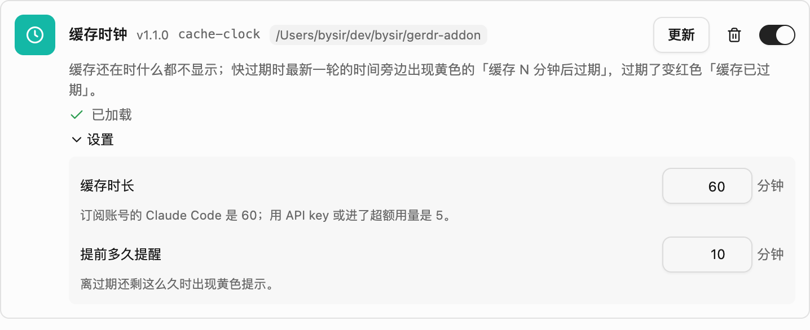

# 缓存时钟

Claude Code 的提示缓存还在时什么都不显示。快过期时，最新一轮下面的时间变黄，旁边出现「缓存 N 分钟后过期」；过期了变红，显示「缓存已过期」—— 这时候下一句会全价重读整段对话，也更慢。

只看 Claude Code 会话的最新一轮（更早几轮的时间跟缓存无关）。

## 设置

在「设置 → 扩展 → 已安装 → 缓存时钟 → 设置」里改：

- **缓存时长**（默认 60 分钟）：订阅账号的 Claude Code 是 60；用 API key 或进了超额用量是 5。
- **提前多久提醒**（默认 10 分钟）：离过期还剩这么久时出现黄色提示。

设置存在 gerdr 里，电脑和手机上一样，改了马上生效。

## 准不准

是估算：缓存从这一轮**最后一次请求开始**时算起，这里用的是这一轮结束的时间，所以会多估出最后那次请求自己的耗时（一般几秒到一两分钟）。

用到的扩展能力：`g.turnStat` 装饰每轮下面那行、`addon.json` 的 `settings` + `g.settings.get`。
