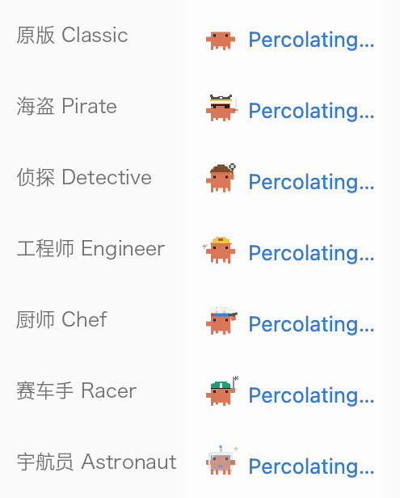
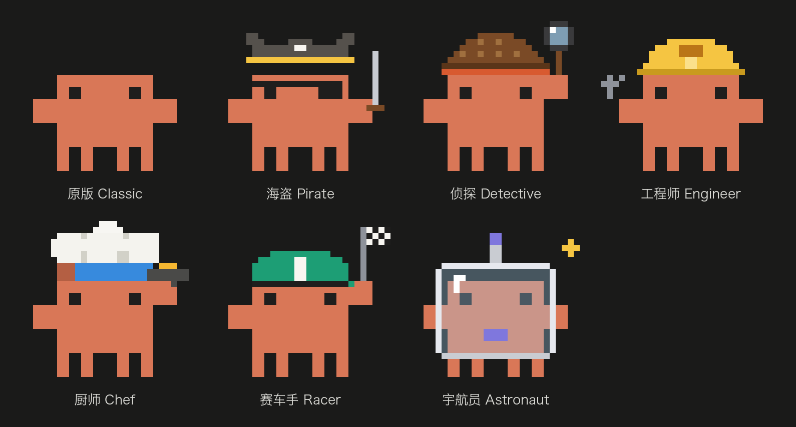

# Pixel Clawd

Seven pixel Clawds for Gerdr: put one in place of the 3×3 working dots in front of a running turn ("Pondering…"),
and any of them on an add-on button in the column on the far left.

- **Running**: it walks and plays with its prop (the pirate fences, the detective sweeps the magnifier, the engineer
  turns the wrench, the chef tosses the omelette, the racer runs with a fluttering flag, the astronaut floats).
- **Waiting on you** (a permission, a question): it stands still, breathing, and waves its free claw.
- **On a button**: the costume standing still, since that column is always in sight.

## Using it

Installing it changes nothing by itself; the Clawds are sprites you place:

- **Working indicator**: Settings → General → Loading 动画, pick a costume. "Gerdr's dots" there brings the dots back.
- **Button icon**: Settings → Add-ons → 分组, click a group's icon, pick a costume under 素材.

Each place can have its own costume.

## Settings

Settings → Add-ons → Pixel Clawd → **Size as the working indicator**: Small 18×12 (default) or Medium 24×16.
Medium is one CSS pixel per grid cell, so its edges are crisper.

## Requires

Gerdr from November 2026 with Settings → General → Loading 动画 (`g.slot("sprite")`); an older one shows "update Gerdr
first" under the add-on in Settings.

## Credits

The pixel art and animations come from [savvy-progress](https://github.com/johnnyvizz/claude-kit/tree/main/plugins/savvy-progress)
by johnnyvizz (MIT), itself traced from DockCrab. Clawd is Anthropic's mascot; this is an unofficial community add-on,
not affiliated with or endorsed by Anthropic.
