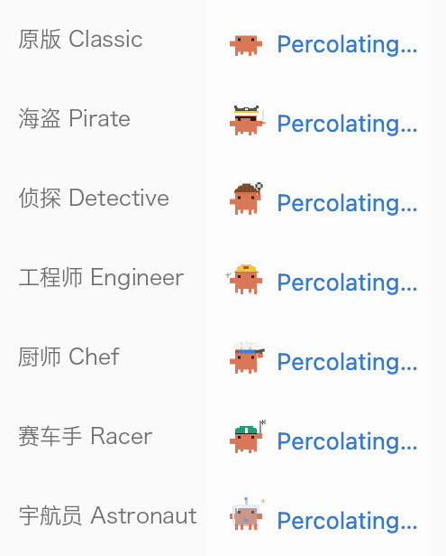
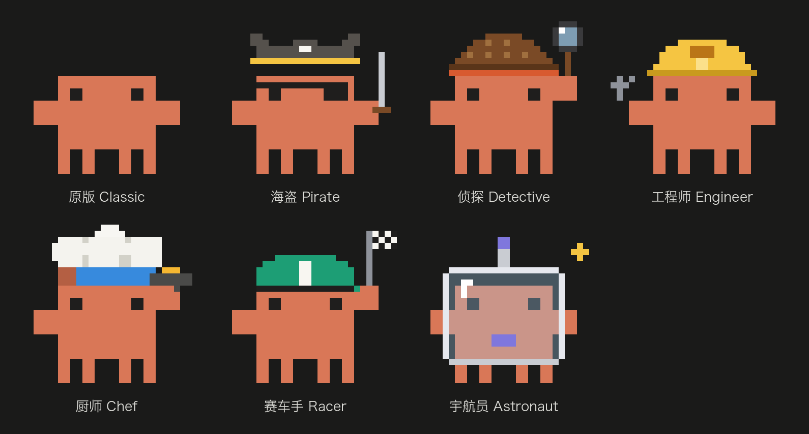

# 像素 Clawd

把对话运行中那个 9 个点的 loading（「Pondering…」前面那个）换成像素小螃蟹 Clawd。

- **运行中**：走路，手里的道具在动（海盗挥刀、侦探扫放大镜、工程师拧扳手、厨师颠锅翻蛋、赛车手快跑摇旗、宇航员漂浮）。
- **等你确认**（权限、提问）：停下来轻轻呼吸，空着的爪子朝你挥。

## 设置

设置 → 扩展 → 像素 Clawd：

- **造型**：原版、海盗、侦探、工程师、厨师、赛车手、宇航员。
- **尺寸**：小 18×12（默认）或中 24×16。中号每格正好 1 个像素，边缘更清楚。

关掉或删除扩展，就回到 Gerdr 自己的点点。

## 需要

2026 年 11 月之后的 Gerdr（`g.slot("loader")`）；旧版本会在扩展设置里提示先更新 Gerdr。

## 来源

像素画和动画来自 [savvy-progress](https://github.com/johnnyvizz/claude-kit/tree/main/plugins/savvy-progress)（johnnyvizz，MIT），
它又是从 DockCrab 描出来的。Clawd 是 Anthropic 的吉祥物，本扩展是非官方的社区作品，和 Anthropic 无关。
