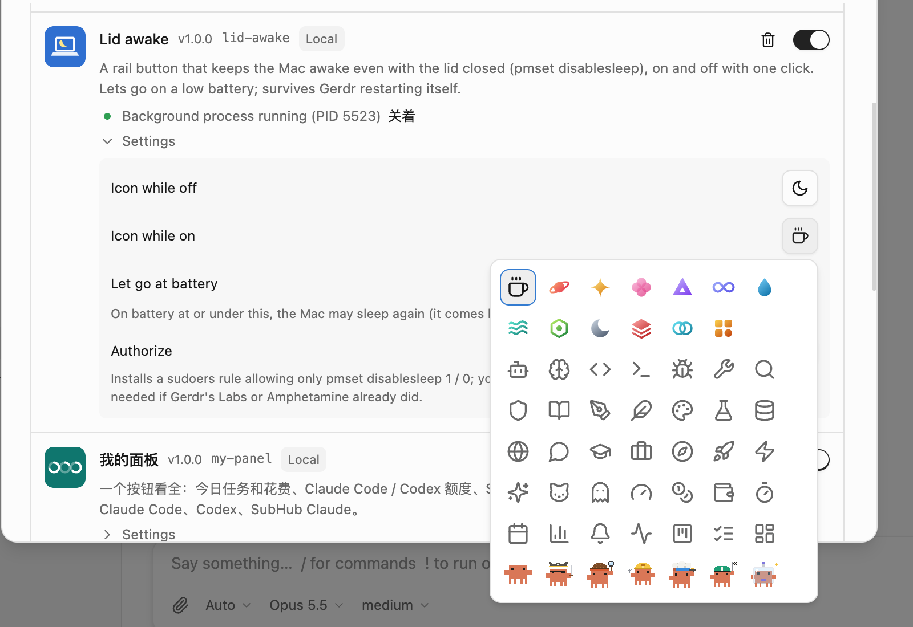

# Lid awake

A rail button: click it and the Mac stays awake even with the lid closed; click again to turn it off. It uses `pmset -a disablesleep`, as Amphetamine's closed-lid mode does, so idle sleep is blocked too while it's on (the screen still turns off).

- **The button is the switch**: clicking it doesn't open a panel. While on, it has an accent background; while on but let go because of a low battery, a warning colour. Clicking the button's edge opens a panel with the state, the battery and a switch. The command palette has "Lid awake: toggle" too.
- **Pick both icons** (Settings → Add-ons → Lid awake → Settings): the same picker as an agent's icon, with built-in glyphs, line icons, and pictures that sprite add-ons bring (Pixel Clawd, for example).
- **Let go at battery**: on battery at or under this percentage, it stops keeping the Mac awake, and resumes once the Mac is plugged in. Default 20%; 0 means never.
- **Authorize once**: `pmset disablesleep` needs root. Press "Authorize" in the settings and enter your password once on this computer. That installs a sudoers rule allowing only `pmset -a disablesleep 1` / `0` (`/etc/sudoers.d/gerdr_lid_awake`). If Gerdr's Labs or Amphetamine already authorized it, you don't need to.

## When Gerdr restarts

Gerdr updates and restarts itself when idle, and this background process restarts with it. If the process turned disablesleep off on the way out, a Mac with its lid closed would fall asleep before the new process started, and then the new process would never start. So while it's on, quitting hands the mode over to the next copy instead of turning it off. If a new copy takes over within 2 minutes, the mode stays on. If nothing takes over (Gerdr quit for good), a timer turns it off. Whether it's on is kept in `~/.gerdr/addon-data/lid-awake/`, so it survives restarts.

## Notes

- macOS only.
- disablesleep is one switch for the whole computer. Turning the mode off here only undoes what this add-on turned on; it leaves anyone else's (Gerdr Labs, Amphetamine) alone. While the mode is on here, it checks every 30 seconds and turns disablesleep back on if something else turned it off.
- A closed laptop in a bag gets hot and drains its battery, which is why the low-battery line exists.
