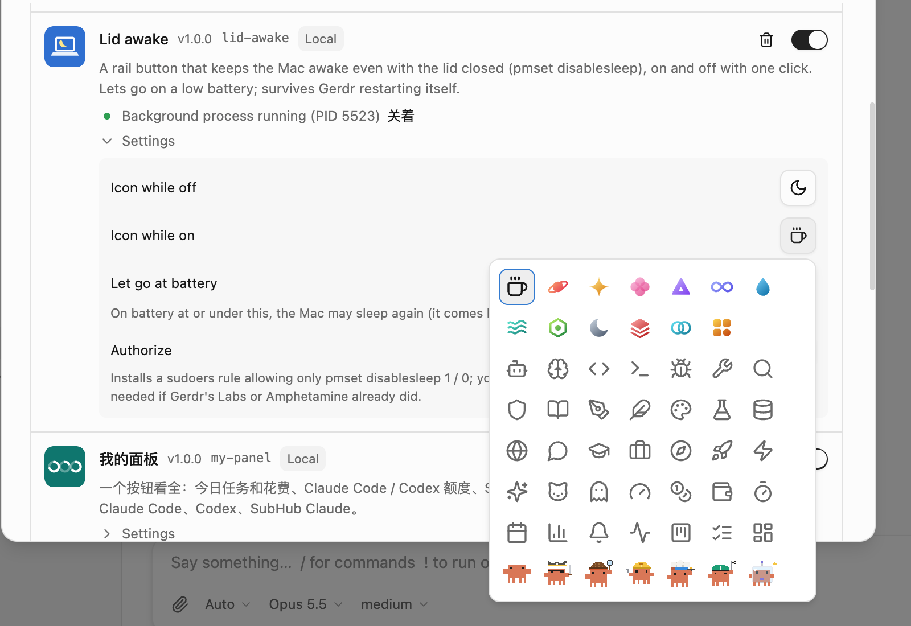

# 合盖不休眠

rail 上一个按钮：点一下，Mac 合上盖子也不睡；再点一下关。和 Amphetamine 的「合盖模式」一样走 `pmset -a disablesleep`，开着时闲置也不睡（屏幕照常熄）。

- **点按钮就是开关**，不弹面板。开着时按钮带强调色底；开着但因为电量低暂时放手时是警示色。点按钮边缘会打开面板，里面有现在的状态、电量和一个开关。命令面板里也有「合盖不休眠：开 / 关」。
- **两个图标可以自己选**（设置 → 扩展 → 合盖不休眠 → 设置）：和 agent 头像一样的选择器，有内置图标、线条图标，还有素材扩展（比如像素 Clawd）带来的图。素材扩展里会动的图，默认开着时动起来（「动态图标」：开着时动 / 一直动 / 不动）。
- **电量低于多少放手**：用电池且电量 ≤ 这个数时不再挡着睡眠，插上电自动回来。默认 20%，0 = 一直不放手。
- **第一次要授权**：`pmset disablesleep` 要 root。点设置里的「授权」，在电脑上输一次密码（授权过了这一行会显示「已授权」），装一条只放行 `pmset -a disablesleep 1` / `0` 的 sudoers 规则（`/etc/sudoers.d/gerdr_lid_awake`）。Gerdr 实验室里或 Amphetamine 授权过的话就不用再授权。

## Gerdr 重启的时候

Gerdr 有空闲时会自己升级重启，后台进程也跟着重启。如果退出时关掉 disablesleep，合着盖子的 Mac 会在新进程起来之前就睡着，然后新进程就起不来了。所以开着时退出不关它，而是交给下一个进程：新进程 2 分钟内接手就一直开着，没人接手（比如 Gerdr 彻底退了）就到时自动关。开没开记在 `~/.gerdr/addon-data/lid-awake/` 里，重启后照旧。

## 注意

- 只支持 macOS。
- disablesleep 是整台电脑共用的一个开关。这里关掉时，只关自己打开的那次，别人（Gerdr 实验室、Amphetamine）开的不动。这里开着时，每 30 秒检查一次，被别的程序关掉了就重新打开。
- 合着盖子放包里会发热、耗电：低电量这条线就是为这个设的。
