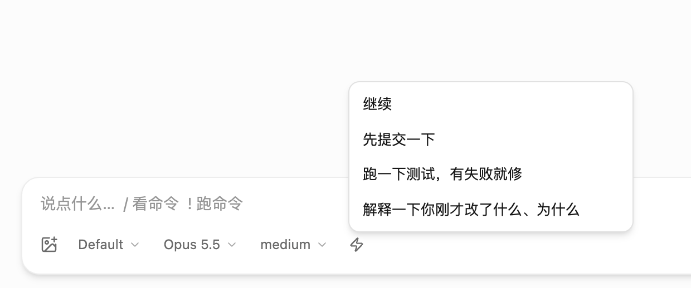

# 常用短语

一天要打几十遍的话，点一下就填进输入框：输入框底栏多一个 ⚡ 按钮，点开选一句，接在你正在打的字后面（不会直接发出去）。

- 默认有「继续」「先提交一下」「跑一下测试，有失败就修」「解释一下你刚才改了什么、为什么」。
- 改成自己的：命令面板（prefix+:）里找「编辑常用短语」，一行一条。存在这个浏览器 / App 里。
- 在对话里选中一段文字、右键 →「引用到输入框」，以 `> ` 引用的形式填进那个会话的输入框（桌面 App 和安卓 App 里；浏览器保留它自己的右键菜单）。

用到的扩展能力：`g.composerAction` 往输入框底栏加按钮、`g.contextMenu` 加右键菜单项、`g.command` 加命令、`g.storage`。
