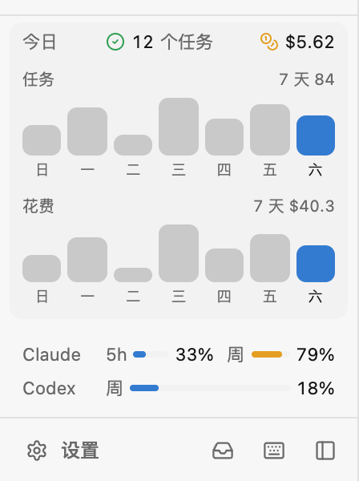

# 今日

侧栏里一行：今天 agent 跑完了几个任务、花了多少钱。点开是最近 7 天的柱状图。

- **任务**：你发出去、正常结束的一轮算一个。被你打断的、出错的不算；agent 自己开的轮次（后台任务跑完了它回来汇报）也不算。Claude Code 和 Codex 都算。
- **花费**：Claude Code 自己报的每一轮的钱数（和 `/cost` 一样，按 API 价格估算，不是实际账单）；Gerdr Agent 只报 token，按设置里的**模型价格**表换算（每行 `模型 输入 输出 缓存读 缓存写`，美元 / 百万 token，`*` 通配）。表里没有的模型不计入，金额后面会带个 `*`，鼠标放上去能看到是哪几个。Codex 只报 token 不报钱，不计入。
- Gerdr 后端把每一轮的记录（`g.turns()`）记一次，怎么数由这个扩展决定，所以几个窗口、手机上看到的都一样。按轮次结束那天算到哪一天。

用到的扩展能力：`g.slot("sidebar")`、`g.turns()`、`g.on("turn")` 和 `g.settings`（价格表是 `text` 类型的设置）。旧版 Gerdr 没有 `g.turns()` 时，退回用它自己统计的 `g.stats()`。
