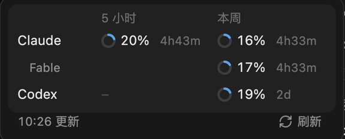

# 额度条

侧栏底部常驻 Claude Code 和 Codex 的套餐额度，是一张小表：列是「5 小时」和「本周」，每家一行，每格一个圈加用了多少。圈的颜色：70% 以下是主题色，70% 起变黄，90% 起变红。点一下展开，每格后面多出多久后重置（4h45m、5d8h），按模型的周额度（比如 Fable）缩进挂在下面；鼠标停上去看重置的具体时间。

- 每 3 分钟刷新一次（窗口在前台时）；展开后有「刷新」按钮。gerdr 后端有缓存，开着几个窗口也只问一次。
- 用 API key、Bedrock 这类没有套餐额度的账号不显示。
- 拿不到时显示「拿不到」，鼠标停上去看原因。

用到的扩展能力：`g.slot("sidebar")` 往侧栏放组件、`g.usage()` 读额度、`g.ui` / `g.icons` 用 gerdr 自己的样式。
