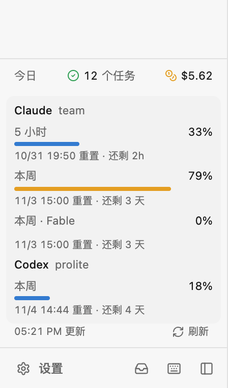

# 额度条

侧栏底部常驻 Claude Code 和 Codex 的套餐额度：收起时每家一行，显示 5 小时窗口和本周用了多少；点一下展开，能看到全部额度（含按模型的周额度）和各自什么时候重置。

- 每 3 分钟刷新一次（窗口在前台时）；展开后有「刷新」按钮。gerdr 后端有缓存，开着几个窗口也只问一次。
- 用 API key、Bedrock 这类没有套餐额度的账号不显示。
- 拿不到时显示「拿不到」，鼠标停上去看原因。

用到的扩展能力：`g.slot("sidebar")` 往侧栏放组件、`g.usage()` 读额度、`g.ui` / `g.icons` 用 gerdr 自己的样式。
